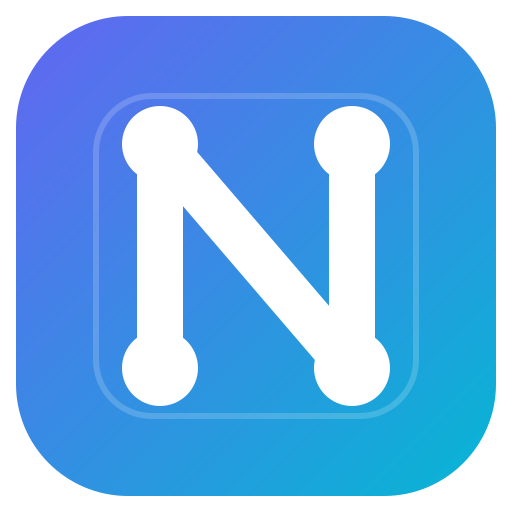

<p align="center">
  
</p>

<h1 align="center">NodeUI</h1>

<p align="center">
Bahasa pemrograman khusus <strong>UI web</strong> (ekstensi <code>.nui</code>) dengan compiler <strong>Rust</strong>.
</p>

---

Hasil build adalah modul JavaScript yang dirender di browser memakai DOM/Shadow DOM.

NodeUI hanya mendeskripsikan **struktur, state, binding, event, dan style**. Semua logika berat
(algoritma, `fetch`, kalkulasi) ditulis di JS/TS biasa lalu diimpor ke `.nui`.

```nui
page Home {
    use { muatUser } from "./logic.ts"
    state nama = ""

    Card {
        Text { "Halo {nama}" }
        Button(on:click = muatUser) { "Muat" }
    }
}
```

---

## Arsitektur

```text
src/
  tokenizer.rs   -> token + lokasi (baris/kolom)
  ast.rs         -> node AST (Program, ElementNode, Attribute, StateDecl, ImportDecl, TextNode)
  parser.rs      -> token stream -> AST
  scope.rs       -> analisis scope per node + resolusi state
  validator.rs   -> aturan isolasi node + larangan logika berat
  generator.rs   -> JavaScript (DOM/Shadow DOM) + CSS ter-scope
  compiler.rs    -> pipeline compile/build + impor .js/.ts + aset
  runtime.js     -> runtime browser: state reaktif, h(), shadow root, overlay layer
  dev.rs         -> server dev + live reload (SSE)
  main.rs        -> CLI `nui`
tests/
  parser.rs, validator.rs, generator.rs, build.rs, piano.rs
  fixtures/      -> contoh valid, contoh error, impor TS
  dom-stub.js    -> stub DOM untuk smoke test runtime
examples/
  piano/piano.nui + piano-logic.js
assets/          -> logo (SVG/PNG) + icon.ico
installer/       -> skrip Inno Setup
scripts/         -> generator ikon + build installer
.github/         -> workflow rilis
```

Pipeline: `.nui` -> **tokenizer** -> **parser** -> **AST** -> **validator** -> **generator** -> `dist/`.

Compiler dan CLI tidak memakai crate eksternal. TypeScript hanya dibutuhkan bila proyek
mengimpor berkas `.ts`.

---

## Aturan isolasi node (WAJIB)

| Lapis | Mekanisme |
|---|---|
| **AST** | Setiap elemen adalah scope. `state` hanya terlihat oleh node itu dan turunannya. Mengakses state di luar scope -> error compile (baris/kolom). |
| **Style** | CSS di-scope per node lewat atribut `data-nui-scope`. Guard `:not(...)` mencegah aturan node luar menimpa node dalam. |
| **DOM** | Halaman dirender di dalam **Shadow DOM** -> DOM & CSS internal tidak bocor ke dokumen. |
| **Overlay** | Satu-satunya pengecualian resmi: node `overlay` dirender ke **layer terpisah** di `document.body`. |

Semua pelanggaran dilaporkan dengan lokasi yang jelas:

```text
[error] Validasi gagal (3 masalah):
  - Binding 'namaLain' di luar scope node ini dan induknya (pelanggaran isolasi node) (baris 4, kolom 17)
    -> tests/fixtures/errors.nui:4:17
  - Handler 'handlerYangBelumDiimpor' tidak ditemukan. Impor dengan 'use { ... } from "./logic.js"'. (baris 5, kolom 16)
  - Logika berat tidak diizinkan di dalam .nui (state 'x'). Pindahkan ke file JS/TS lalu impor dengan 'use'. (baris 8, kolom 15)
```

### Batas scope CSS

Node yang punya atribut `style` menjadi **batas scope**: aturannya hanya berlaku pada node itu
sendiri dan turunannya **sampai node anak yang juga punya `style`**.

```nui
Brand(style = "h1 { font-size:20px; margin:0 }") {
    Title { "NodeUI Piano" }
}
```

Properti yang di-*inherit* (warna, font-family) tetap mengalir seperti CSS biasa.

---

## Sintaks

### Node

Semua elemen adalah node: `Nama(atribut) { anak }`. Nama node wajib diawali huruf kapital.

```nui
Card { Text { "Halo" } Button { "Klik" } }
```

Konvensi nama node -> tag HTML:

| Pola | Tag | Contoh |
|---|---|---|
| nama baku HTML | sama | `Video` -> `<video>`, `Progress` -> `<progress>` |
| nama baku + sufiks | tag baku | `NextButton` -> `<button>`, `VolumeSlider` -> `<input>`, `StatusBadge` -> `<span>` |
| lainnya | `<div>` (block) | `NowPlaying`, `Controls`, `Player` |

### Atribut

`nama = "nilai"` · `on:click = namaFungsi` · atribut boolean tanpa nilai: `disabled`, `controls`.

```nui
Button(on:click = muatUser, class = "utama") { "Klik" }
```

Atribut juga boleh ditulis **satu per baris** di dalam tubuh node:

```nui
page Piano {
    on:ready = siap
    on:keydown = tekanTombol
}
```

Atribut `id` mendaftarkan elemen ke `ctx.refs` sehingga logika eksternal bisa mengaksesnya.

### Komentar

```nui
// komentar satu baris
/* komentar banyak baris */
```

### Event pada node `page`

Event di node `page` dipasang **global di `window`**:

```nui
page Piano {
    on:keydown = tekanTombol
    on:keyup = lepasTombol
    on:ready = siap      // dipanggil sekali setelah halaman terpasang
}
```

### State

```nui
state nama = ""
state jumlah = "0"
```

State hanya berupa literal; nilai dinamis berasal dari logika eksternal.

### Binding

`{nama}` di dalam teks atau atribut disisipkan otomatis dan reaktif:

```nui
Text { "Halo {nama}" }
```

### Import logika

```nui
use { muatUser, tambahKlik } from "./logic.ts"
use { muatUser } from "./logic.js"
```

Handler event harus berasal dari `use` (fungsi eksternal), bukan kode inline.
Path impor harus relatif, berakhiran `.js` atau `.ts`, dan tetap berada di dalam folder proyek.
Nama yang diimpor dan nama handler harus berupa identifier JavaScript yang valid (bukan kata kunci).

### Keamanan

- Atribut `on*` (mis. `onclick`) dan `srcdoc` tidak dipasang oleh runtime; event hanya lewat `on:...`.
- URL pada `href`, `src`, `poster`, `action`, dan `formaction` yang memakai skema `javascript:`,
  `vbscript:`, atau `data:text/html` diganti menjadi `#`.
- Judul halaman di-escape saat ditulis ke `index.html`.
- Server dev hanya bind ke `127.0.0.1`, menolak path di luar folder build (termasuk symlink),
  membatasi panjang request line, timeout koneksi, dan jumlah klien live reload.

### Style

Style ditulis sebagai **blok** agar CSS panjang tetap terbaca dan tidak menjadi satu baris.
Indentasi blok otomatis dirapikan (dedent). Bentuk **deklarasi** berlaku pada node itu sendiri,
bentuk **rule** berlaku pada turunannya. Keduanya boleh digabung:

```nui
Card(style {
    border: 1px solid #ccc;
    padding: 16px;
}) { ... }

Box(style {
    span { font-weight: bold; }
}) { ... }

Shell(style {
    color: #eee;

    h1 {
        font-size: 20px;
        margin: 0;
    }
}) { ... }

Key(style {
    background: #fff;

    &.tekan { background: #4f8cff; }
    &::after { content: attr(note); }
}) { ... }
```

Blok `style` juga boleh diletakkan di dalam tubuh node, dengan atau tanpa `=`:

```nui
Card {
    style {
        border: 1px solid #ccc;
    }
    Text { "Halo" }
}
```

Bentuk lama `style = "..."` tetap didukung untuk CSS pendek:

```nui
Card(style = "border:1px solid #ccc;padding:16px;") { ... }
```

`&` berarti "node itu sendiri". Untuk menata anak, tulis selector biasa
(mis. `.key.white { ... }`) dan letakkan blok `style` pada induknya.

> Catatan: di dalam blok `style`, kurung kurawal selalu dibaca sebagai blok CSS
> (bukan binding state).

### Overlay (layer terpisah)

```nui
overlay InfoModal {
    Panel { Text { "Ini modal." } }
}
```

---

## Instalasi

Windows 10/11 (x64) tersedia dalam dua bentuk dari halaman
[Releases](https://github.com/zulsyam23-dot/nui/releases):

- **Installer** `NodeUI-<versi>-setup.exe` — dipasang per pengguna (tanpa admin),
  menambahkan `nui` ke `PATH`, serta menyertakan contoh dan dokumentasi.
- **Portable** `NodeUI-<versi>-portable.zip` — ekstrak lalu jalankan `nui.exe`.

Setelah installer selesai, buka terminal baru:

```powershell
nui check examples\piano\piano.nui
nui dev examples\piano\piano.nui
```

Linux dan macOS dapat membangun dari sumber:

```bash
cargo build --release
```

---

## Build & CLI

```bash
cargo build --release
```

Binary ada di `target/release/nui` (`target\release\nui.exe` di Windows).

```bash
target/release/nui build examples/piano/piano.nui
target/release/nui build examples/piano/piano.nui --out out
target/release/nui dev examples/piano/piano.nui
target/release/nui dev examples/piano/piano.nui --port 4000
target/release/nui check examples/piano/piano.nui
```

Atau lewat Cargo:

```bash
cargo run --quiet -- build examples/piano/piano.nui
cargo run --quiet -- dev examples/piano/piano.nui
cargo run --quiet -- check examples/piano/piano.nui
```

`nui build` menghasilkan:

```text
dist/
  output.js   # hasil compile (ES module)
  runtime.js  # runtime browser
  style.css   # CSS ter-scope (salinan untuk inspeksi; halaman memakai Shadow DOM)
  index.html  # halaman demo
  logic.js    # logika eksternal (disalin / ditranspile)
  assets/     # aset lokal (src/href/poster + aset yang dirujuk logika)
```

`nui dev` menyajikan `dist/` di `http://localhost:3456`, memantau `.nui` serta berkas logika
yang diimpor, lalu memuat ulang browser otomatis saat ada perubahan.

Jika mengimpor `.ts`, pasang TypeScript sekali:

```bash
npm install
```

---

## Logika eksternal

Semua kerja berat di luar `.nui`:

```js
// examples/piano/piano-logic.js
export function muatUser(event, { state }) {
  state.set('nama', 'Budi Santoso');
}
```

Signature handler: `(event, ctx)` dengan
`ctx = { state, setState, refs, overlay, overlayBody }`.

| ctx | Kegunaan |
|---|---|
| `ctx.state` | `get()` / `set(key, value)` |
| `ctx.setState` | alias cepat `state.set` |
| `ctx.refs` | elemen ber-`id` (mis. `ctx.refs.player`) |
| `ctx.overlay` | elemen host layer overlay |
| `ctx.overlayBody` | root layer overlay (append elemen dari logika) |

---

## Contoh aplikasi

`examples/piano` berisi **aplikasi piano lengkap**: 17 tombol (10 putih + 7 hitam), sintesis suara
Web Audio, pedal sustain, penggeser oktaf, dan slider volume.

```bash
target/release/nui dev examples/piano/piano.nui     # http://localhost:3456
```

| Tombol keyboard | Fungsi |
|---|---|
| `A S D F G H J K L ;` | nada putih (C-E) |
| `W E T Y U O P` | nada hitam (C#-D#) |
| `Z` / `X` | turun / naik oktaf |
| `Spasi` | pedal sustain (tahan) |

Struktur, state, event, dan style seluruhnya ada di `piano.nui`; sintesis suara,
pemetaan keyboard, dan penempatan tombol hitam ada di `piano-logic.js`.

---

## Menjalankan test

```bash
cargo test
cargo fmt --all -- --check
cargo clippy --all-targets -- -D warnings
```

Atau lewat package script:

```bash
npm test
npm run lint
npm run fmt
```

Test mencakup parser, validator/isolasi scope, generator, build penuh, resolusi aset,
transpile TypeScript, CLI, validitas sintaks JavaScript hasil build, reaktivitas runtime,
overlay, serta aplikasi piano (keyboard, oktaf, sustain, volume, mouse).

---

## Rilis

Build installer Windows dan paket portable:

```powershell
powershell -NoProfile -ExecutionPolicy Bypass -File scripts\build-installer.ps1
```

Hasil ada di `release/`:

```text
NodeUI-<versi>-setup.exe
NodeUI-<versi>-portable.zip
NodeUI-<versi>-windows-x64.exe
```

Logo dan ikon dapat dibuat ulang dengan:

```powershell
powershell -NoProfile -ExecutionPolicy Bypass -File scripts\make-icon.ps1
```

Workflow `.github/workflows/release.yml` akan membuat installer dan menerbitkan GitHub Release
setiap kali tag `v*` didorong:

```bash
git tag v0.2.0
git push origin v0.2.0
```
